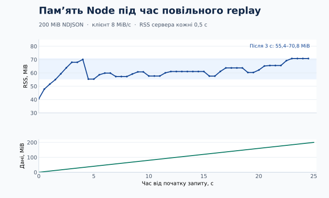

# Dogfight — Lab 04

Dogfight — браузерна гра на JavaScript і Canvas 2D. Node.js-сервер обслуговує клієнт, керує кімнатами, передає список учасників та чат через WebSocket і зберігає події матчу в NDJSON. Положення кораблів, кулі й колізії поки обчислюються окремо в кожному браузері. Синхронізація ігрового стану не входить до Lab 04.

[Lab 01 · Ігровий цикл](https://github.com/AnastasiaHolz/dogfight/tree/lab-01) · [Lab 02 · Сутності](https://github.com/AnastasiaHolz/dogfight/tree/lab-02) · [Lab 03 · Асинхронність](https://github.com/AnastasiaHolz/dogfight/tree/lab-03)

## Запуск

Потрібен Node.js 24 LTS. Команди виконуються з кореня репозиторію. У Windows PowerShell можна використовувати `npm.cmd`, якщо запуск `npm.ps1` заблоковано.

```sh
npm ci
npm run build
npm start
```

Зібраний клієнт доступний на **http://127.0.0.1:3000**. Для запуску з гарячим оновленням використовується два термінали:

| Термінал | Команда              | Призначення                                        |
| -------- | -------------------- | -------------------------------------------------- |
| 1        | `npm run dev:server` | Node.js з перезапуском при змінах сервера          |
| 2        | `npm run dev:client` | Vite та проксі `/api`, `/health`, `/ws` на Node.js |

Адреса Vite вказана в рядку **Local**, зазвичай `http://localhost:5173`. У лобі перший учасник створює кімнату. Другий учасник відкриває ту саму адресу в іншому вікні, оновлює список і приєднується до тієї самої кімнати під іншим ім’ям. Чат і список учасників спільні для кімнати.

## Структура та конфігурація

`client/` і `server/` — npm workspaces зі спільним `package-lock.json`. Обидва пакети використовують ESM. Вбудовані модулі Node імпортуються через префікс `node:`. Зібрані файли клієнта потрапляють у `client/dist/`.

Параметри середовища перевіряються в `server/src/config.js`. Команди запуску читають кореневий `.env`, якщо він є. Приклад наведено в `.env.example`.

| Змінна       | Типове значення | Призначення                                           |
| ------------ | --------------- | ----------------------------------------------------- |
| `HOST`       | `127.0.0.1`     | Адреса прослуховування                                |
| `PORT`       | `3000`          | Порт Node-сервера                                     |
| `LOG_DIR`    | `logs`          | Каталог логів, відносно кореня проєкту або абсолютний |
| `LAB04_DEMO` | `0`             | `1` вмикає `/api/slow` лише для loopback HOST         |

На `SIGINT` або `SIGTERM` сервер припиняє приймати з’єднання, закриває WebSocket, завершує потоки запису та виходить із кодом `0`. Для локального завершення використовується **Ctrl+C**.

## HTTP і WebSocket

| Метод і шлях           | Призначення                                                              |
| ---------------------- | ------------------------------------------------------------------------ |
| `GET /health`          | Стан сервера                                                             |
| `GET /api/rooms`       | Поточні кімнати, їхні арени й кількість гравців                          |
| `POST /api/rooms`      | Створення кімнати з JSON `{ "name": "Orion", "preset": "orbit" }`        |
| `GET /api/replays/:id` | Потокове завантаження завершеного NDJSON-логу                            |
| `GET /api/slow`        | Локальний дослід із блокуванням JS на 300 мс, вимкнений за замовчуванням |
| `/ws`                  | Оновлення HTTP-з’єднання до WebSocket                                    |

Статичні файли віддаються з відповідним MIME-типом. Сервер перевіряє початковий запит і декодований шлях перед пошуком файлу: сегменти `..` відхиляються, а остаточний шлях не може виходити за межі `client/dist`. Тіло `POST /api/rooms` обмежено 2 KiB.

Протокол **v0** використовує текстові JSON-повідомлення з полем `v: 0`. Клієнт надсилає `join`, `chat` і `leave`. Сервер повертає `joined`, розсилає `roster` на вході й виході та пересилає `chat` із даними гравця, визначеними сервером. Кімната є `EventEmitter` з подіями `join`, `leave`, `chat` та `empty`. Вона видаляється після виходу останнього учасника, а створена, але ще не відвідана кімната зникає через 90 с.

На сервері діють ліміти **16 кімнат**, **6 учасників у кімнаті**, **4 KiB на WebSocket-повідомлення** та **8 повідомлень/с** на з’єднання з коротким запасом у 12. На `join` відведено **5 с**. Сервер надсилає ping кожні **15 с** і обриває з’єднання після двох пропущених відповідей. Якщо `bufferedAmount` перевищує 64 KiB, чат не додається до черги цього клієнта. Якщо не можна надіслати критичне повідомлення, з’єднання закривається з `1013`.

Непідтримувані двійкові повідомлення закриваються з `1003`, некоректний JSON — з `1007`, неправильна версія, тип або форма — з `1008`, завелике повідомлення — з `1009`. Для відсутньої кімнати, переповнення, таймауту входу й ліміту частоти використовуються окремі коди `4404`, `4403`, `4408` та `4429`.

Клієнтська обгортка тримає до 16 повідомлень до підтвердження `joined` і надсилає їх з інтервалом, щоб не вичерпати серверний ліміт одразу. Після неочікуваного відключення пауза перед спробою зростає від 250 мс до 4 с. Повторне підключення знову виконує `join`. Якщо кімнату вже видалено, клієнт повертається в лобі.

## NDJSON і backpressure

Події кімнати проходять через об’єктний `Transform`, який записує один JSON-об’єкт на рядок. `pipeline()` передає дані у файловий потік. Після завершення матчу тимчасовий файл перейменовується на `<id>.ndjson`; тоді запис стає доступним через HTTP. Посилання на лог з’являється після повернення до лобі, але файл доступний лише після виходу останнього учасника. Replay передається через `createReadStream()` і `pipeline()`, без читання повного файла в пам’ять. Для програмного читання подій є асинхронний генератор `replayEvents()`.

Коли `write()` повертає `false`, отримувач не встигає приймати дані. Виробник має дочекатися `drain` або покластися на `pipeline()`, який призупиняє читання. Це відрізняється від політики WebSocket: там `bufferedAmount` перевіряється перед надсиланням, а некритичні повідомлення можна пропустити.

### Вимірювання RSS



Дослід на Linux та Node.js **24.22.3**: клієнт завантажував **200 MiB** реальним маршрутом replay зі швидкістю **8 MiB/с**. Вимірювався RSS окремого серверного процесу кожні **0,5 с**. Генерація лог-файла й отримання відповіді відбувалися поза цим процесом. Завантаження тривало **25,0 с**. RSS зріс на старті, потім коливався в межах **55,4–70,8 MiB** після третьої секунди. Він не зростав пропорційно обсягу переданих даних.

Команда відтворення — `npm run bench:replay`. Необроблені значення контрольного прогону збережено в [docs/replay-rss.json](docs/replay-rss.json).

## Цикл подій і помилки

Node.js виконує JavaScript у головному потоці, а I/O обслуговує libuv. Фаза `poll` обробляє готові події I/O, `check` — колбеки `setImmediate()`, фаза таймерів — готові `setTimeout()` і `setInterval()`, а фази `pending callbacks` і `close callbacks` мають окремі черги. `process.nextTick()` і реакції промісів не є окремими фазами libuv. У звичайному I/O-колбеку `nextTick` має пріоритет над Promise-реакціями. Під час верхньорівневого виконання ESM порядок може відрізнятися.

Якщо HTTP-обробник на 300 мс займе потік синхронним циклом, сервер не зможе виконувати інші JS-колбеки, хоча ОС і далі прийматиме мережеві дані. Дослід `npm run demo:loop` запускає окремий локальний сервер. У контрольному прогоні кругова затримка чату була **1,1 мс** без блокування і **307,9 мс** під час запиту до `/api/slow`.

`EventEmitter.emit("error", error)` без слухача синхронно кидає помилку. Якщо вона пошириться назовні необробленою, процес завершиться. Дослід перевіряє обидва випадки в дочірніх процесах:

```text
EventEmitter → exit 1 · Error: demo error
EventEmitter → exit 0 · handled: demo error
```

На сервері слухачі `error` встановлено на HTTP-сервері, WebSocket-сервері, сокетах та кімнатах. Помилки файлових потоків проходять через `pipeline()` і обробляються окремо.

## Перевірка

```sh
npm run check
npm test
npm run build
```

[Методичка Lab 04](https://github.com/rmalkevy/Programming-Practice-Projects/blob/main/courses/javascript/lab-04-node-streams-websockets.md)
