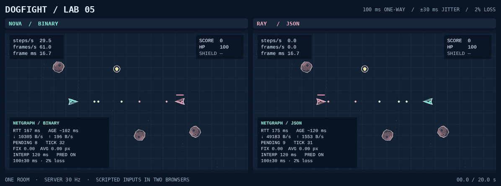

# Dogfight — Lab 05



Dogfight — браузерна гра на JavaScript і Canvas 2D. Починаючи з Lab 05, світ матчу обчислює сервер. Клієнти надсилають команди керування, отримують знімки, передбачають свій рух і плавно відображають інших учасників. Кімнати, чат і потоковий NDJSON-лог залишилися з попереднього етапу.

[Lab 01 · Цикл](https://github.com/AnastasiaHolz/dogfight/tree/lab-01) · [Lab 02 · Сутності](https://github.com/AnastasiaHolz/dogfight/tree/lab-02) · [Lab 03 · Асинхронність](https://github.com/AnastasiaHolz/dogfight/tree/lab-03) · [Lab 04 · Сервер](https://github.com/AnastasiaHolz/dogfight/tree/lab-04)

## Запуск

Потрібен Node.js 24 або новіший. Команди виконуються з кореня репозиторію.

```sh
npm ci
npm run build
npm start
```

Гра доступна за адресою `http://127.0.0.1:3000`. У Windows PowerShell, якщо запуск `npm.ps1` заблоковано, замість `npm` використовується `npm.cmd`. Для розробки `npm run dev:server` і `npm run dev:client` запускаються в окремих терміналах. У цьому режимі Vite проксує HTTP API і WebSocket до Node-сервера.

Перший учасник створює кімнату в лобі, після чого обидва учасники приєднуються під різними іменами. Клавіші `W` і `↑` вмикають тягу, `A/D` і `←/→` повертають корабель, `Space` стріляє, `H` запускає самонавідну кулю. Влучання, знищення, підбирання щита, рахунок і відродження визначає сервер.

## Архітектура мережі

| Пакет     | Відповідальність                                                                                     |
| --------- | ---------------------------------------------------------------------------------------------------- |
| `shared/` | Чиста симуляція, спільна модель польоту, генератор із seed, типи повідомлень, JSON і бінарний кодеки |
| `server/` | Кімнати й чат, приймання команд, авторитетний матч, знімки та статистика                             |
| `client/` | Зчитування вводу, передбачення, звірка, інтерполяція, рендер, звук і netgraph                        |

Кожна зайнята кімната має один `Match`. Сервер крокує зі сталим `dt = 1/30` с, а `setTimeout` планується до наступного **абсолютного** дедлайну від монотонного годинника. Після відставання сервер може виконати до чотирьох кроків за одне пробудження. Якщо й цього недостатньо, пропускаються прострочені дедлайни, але сам крок симуляції не подовжується. `GET /api/stats` повертає номер кроку, цільову частоту, середню тривалість кроку, середнє запізнення таймера й кількість пропущених дедлайнів.

Команди містять `seq`, напрям повороту та прапорці тяги й пострілу. Сервер обробляє не більше однієї команди пілота за крок. Черга має обмежене вікно послідовностей і стартовий буфер на два кроки. Дублі та старі номери ігноруються. Для пропуску між наявними командами сервер коротко зберігає останній рух, не повторюючи постріл. `lastProcessedSeq` повідомляє, до якого номера включно команди вже враховані або пропущені. Номер не пересувається за відсутності новіших команд.

### Передбачення і звірка

Клієнт одразу виконує команду для власного корабля тим самим методом інтеграції, що й сервер. Коли приходить знімок, підтверджені команди вилучаються з черги. Корабель береться зі знімка, а непідтверджені команди застосовуються заново в порядку `seq`. Наприклад, після підтвердження `57` із буфера `55–61` повторно виконуються лише `58–61`.

Різниця позицій за можливості згладжується приблизно за **100 мс**. Відродження не інтерполюється зі старої позиції. Свою кулю клієнт показує одразу, а серверний варіант замінює її за парою «власник + `seq` пострілу». Зіткнення при цьому не передбачаються як остаточні: попадання й рахунок підтверджує сервер.

### Мережеві режими та netgraph

| Параметр URL                    | Ефект                                                                                 |
| ------------------------------- | ------------------------------------------------------------------------------------- |
| `?predict=0&latency=100`        | Свій корабель рухається лише після знімка. Додано 100 мс в один бік.                  |
| `?latency=100&jitter=30&loss=2` | Затримка 100 мс в один бік, розкид ±30 мс і 2% імітованої втрати ігрових повідомлень. |
| `?codec=json`                   | JSON для ігрових пакетів замість бінарного формату.                                   |
| `?drift=1`                      | Навмисна розбіжність локального інтегратора. За замовчуванням вимкнено.               |
| `?interp=120`                   | Затримка відображення чужих сутностей у мілісекундах. Типове значення — 120 мс.       |

Параметри можна поєднувати через `&`. Під час матчу в панелі налаштувань можна змінювати затримку, розкид, втрати, передбачення та інтерполяцію. Кодек задається на підключенні. Втрати й розкид застосовуються до ігрових повідомлень у клієнтській обгортці, а не до пакетів TCP. RTT вимірюється як час проходження `ping/pong` з урахуванням штучних затримок.

Netgraph показує RTT, оцінку віку знімка, байти ігрового payload за секунду в кожному напрямку, довжину черги вводу, останню й згладжену поправки позиції та активну затримку інтерполяції. Вік знімка оцінюється як час після його отримання плюс половина виміряного RTT.

## Бінарний протокол v1

Ігрові кадри читаються через `ArrayBuffer` і `DataView`. Багатобайтові числа — **little-endian**. Вхід у кімнату, чат і roster залишаються JSON v0.

| Повідомлення                | Формат                                                                                                                                               |
| --------------------------- | ---------------------------------------------------------------------------------------------------------------------------------------------------- |
| Input, 7 байтів             | `version:u8`, `type:u8 = 1`, `seq:u32`, `flags:u8`                                                                                                   |
| Заголовок знімка, 12 байтів | `version:u8`, `type:u8 = 2`, `tick:u32`, `lastProcessedSeq:u32`, `count:u16`                                                                         |
| Сутність, 45 байтів         | `id:u32`, `owner:u32`, `seq:u32`, `x/y/vx/vy:f32`, `angle:i16`, `kind/flags/radius/hp/cooldown/shield/guard/respawn/ttl:u8`, `life:u16`, `score:u32` |

У `flags` команди біти 0–1 кодують поворот, біти 2–4 — тягу, звичайний і самонавідний постріл. У знімку біти 0–1 позначають тягу й тип наведення сутності. Кут має крок **π/32768 рад**, близько **0,0055°**. Квантування кута й Float32 дають малу похибку при декодуванні, але не змінюють серверний стан.

## Заміри

### JSON проти DataView

Node.js 24.22.3, однаковий сценарій **480 знімків, 4 гравці, 30 Гц**. Швидкість обчислено для ігрових payload одного клієнта без TCP/WebSocket-заголовків. Час — медіана п’яти прогонів round-trip **encode + decode одного знімка**, після прогріву кодеків. Десятковий KB дорівнює 1000 байт.

| Кодек             | Середній знімок, байт | Вхідний трафік, KB/с | Вихідний трафік, KB/с | Encode + decode знімка, мкс |
| ----------------- | --------------------: | -------------------: | --------------------: | --------------------------: |
| JSON              |               5 668,1 |               170,04 |                  2,47 |                       55,65 |
| Бінарний DataView |                 945,1 |                28,35 |                  0,21 |                        4,34 |

Знімок у бінарному форматі приблизно **у 6 разів менший**. Відтворення — `npm run bench:network`. Первинні результати — [docs/network-benchmark.json](docs/network-benchmark.json).

### Передбачення та навмисна розбіжність

Контрольний прогін у Chromium 153, **100 мс в один бік**, без розкиду й втрат. Затримка руху — час від `keydown` до першої видимої зміни місця свого корабля на Canvas. Це два контрольні спостереження, не середні значення.

| Режим            | RTT, мс | Перший видимий рух, мс |
| ---------------- | ------: | ---------------------: |
| Тільки знімки    |     201 |                  282,1 |
| Із передбаченням |     202 |                   27,9 |

Згладжена поправка позиції у контрольному польоті становила **0,00 px**, після ввімкнення випадкового зсуву в інтеграторі — **27,24 px**, через 1,5 с після вимкнення — **1,95 px**. У звичайній грі перемикач розбіжності вимкнений.

У 20-секундному записі два клієнти з різними кодеками грали в одній кімнаті з параметрами **100 мс ± 30 мс** і **2%** імітованих втрат, із передбаченням та інтерполяцією 120 мс. У кінці прогону netgraph показав RTT **205/201 мс**. Сервер не пропустив дедлайнів, середня тривалість його кроку була близько **0,31 мс**.

[Netgraph під час навмисної розбіжності](docs/drift-netgraph.png) · [Дані браузерного прогону](docs/network-browser.json)

## Дизайн-запис

**Затримка.** Відправлення команди та повернення знімка додають мережевий час. Без передбачення цей час відчувається при натисканні клавіші. Передбачення для власного корабля усуває очікування мережі для зображення руху й пострілу, але не робить попадання авторитетним. Віддалені сутності навпаки показуються в минулому. Інтерполяція між уже отриманими знімками згладжує розкид часу доставки, не вгадуючи майбутні позиції. **120 мс** залишають близько трьох-чотирьох кроків запасу. Менша затримка швидше показує зміни, але частіше залишає клієнта без наступного знімка. Більша робить рух плавнішим за нестабільного каналу, зате показує давніший світ.

**Узгодженість.** Спільний модуль працює без DOM, Node API, `Date.now()` і `Math.random()`. Початкові дані та відродження залежать від серверного seed. Однаковий контрольний сценарій у Node й Chromium дав однаковий хеш **`46f28136`**. Навмисну розбіжність внесено лише до клієнтської діагностичної обгортки інтегратора. Якщо підмішати випадковий зсув, повторне застосування непідтверджених команд не відтворює попередній рух, тому поправки ростуть навіть у відкритому просторі. Окрім такого дефекту, поправки можливі при пропусках вводу, квантуванні та серверних колізіях.

**Авторитетність.** Клієнт не повідомляє, де він перебуває, кого вразив або скільки очок отримав. Сервер перевіряє версію, довжину, поля команди, частоту і номери `seq`. Рух і скорострільність обмежуються серверним кроком і станом корабля. Тому підміна координат або надсилання багатьох команд на один крок не пересуває корабель миттєво. Це не повноцінний античіт і не компенсація затримки на сервері: у Lab 05 колізії оцінюються у поточному серверному світі.

## Перевірка

```sh
npm run check
npm test
npm run build
```

Тести перевіряють детермінізм, порядок байтів, квантування й round-trip, обмеження вводу, окремі ACK для двох клієнтів, узгоджені знімки через обидва кодеки та заміну передбаченої кулі серверною.

[Методичка Lab 05](https://github.com/rmalkevy/Programming-Practice-Projects/blob/main/courses/javascript/lab-05-realtime-networking.md)
